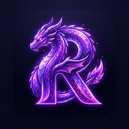

# RenUI | MIMESIS Helper

  

  <b>Универсальный помощник и меню настроек для игры MIMESIS</b> 
  <i>Автор: Pattern | Версия: 1.8.1</i>

---

## ⚡ Особенности RenUI

- 🐉 **Стильный кибер-интерфейс**: Темная палитра с неоновым фиолетовым драконом, перетаскиваемое окно, сворачивание и сохранение настроек.
- 🛡️ **GodMode & Выносливость**: Неуязвимость к урону, бесконечная выносливость, шаги, батарея фонарика и защита от заражения (работает как для хоста, так и для клиентов).
- 💡 **FullBright**: Настраиваемая яркость освещения с ползунком регулировки в реальном времени.
- 🎯 **Кастомный ESP**:
  - **Союзники (Зеленый)**: Никнейм, дистанция, здоровье (HP), заражение.
  - **Враги (Красный)**: Имя/тип, дистанция, HP.
  - **Предметы**: Подсветка лута с дистанцией и ценой.
  - Настройка дальности отображения и размера шрифта.
- 📦 **Спавнер предметов и быстрые бинды**:
  - Спавн в руки или на землю.
  - Привязка любого предмета к горячей клавише (Num1, Num2 и т.д.) с индикацией назначенной кнопки прямо в списке.
  - Отображение цены лута.
- 🚀 **Лаунчер RenUI (.exe)**:
  - Удобный запуск игры в 1 клик через Steam.
  - Преднастройка читов и ESP до запуска игры.
  - **Автоматическая проверка и скачивание обновлений с GitHub** при старте и по кнопке.

---

## 📥 Установка

### Вариант 1: Через лаунчер RenUI (.exe)
1. Скачайте `RenUI.exe` из папки `dist/` или вкладки **Releases**.
2. Поместите в удобное место (например, на рабочий стол) и запустите.
3. Настройте нужные функции и нажмите **«Запустить игру»**. Лаунчер сам проверит актуальность мода и обновит его при необходимости!

### Вариант 2: Вручную для MelonLoader
1. Установите [MelonLoader v0.7.3](https://github.com/LavaGang/MelonLoader).
2. Поместите `RenUI.dll` из `dist/` в папку `MIMESIS/Mods/`.
3. Запустите игру. Меню открывается на клавишу **[F7]**.

---

## ⚙️ Управление в игре

| Клавиша | Действие |
|---|---|
| **F7** | Открыть / закрыть меню RenUI |
| **Кастомные бинды** | Назначаются во вкладке меню «Спавнер» и «Клавиши» |

---

## 🔄 Автообновление

Лаунчер подключен к данному репозиторию:
- При запуске лаунчер проверяет `version.json`.
- Если на GitHub опубликована новая версия, лаунчер автоматически скачивает свежий `RenUI.dll` и обновляет установку в Steam и r2modman!
